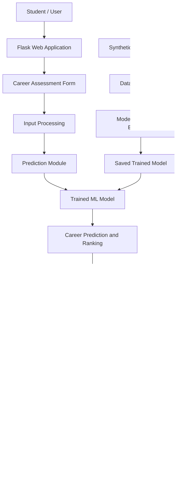

# CareerCompass – Machine Learning Based Career Recommendation System

<p align="center">
  An Intelligent Career Guidance and Skill Gap Analysis Platform
</p>

<p align="center">
  <b>Python | Flask | Scikit-learn | HTML | CSS | JavaScript</b>
</p>

---

## 1. Project Overview

**CareerCompass** is a Machine Learning-based career recommendation and skill gap analysis web application developed using Python and Flask.

The application helps students identify suitable career paths based on their academic qualifications, technical skills, soft skills, and personal interests.

Choosing the right career can be challenging for students because they may not know which professional field matches their existing abilities. CareerCompass addresses this problem by using a trained Machine Learning classification model to analyze student profiles and recommend suitable career options.

Beyond career prediction, the application provides skill gap analysis and personalized learning roadmaps to help students understand which skills they need to improve to pursue their selected careers.

The Flask application provides a customized web interface with interactive career recommendations, skill comparisons, and expandable learning skill trees.

## 2. Project Objectives

- Develop an intelligent career recommendation system using Machine Learning.
- Analyze student academic backgrounds, technical skills, and interests.
- Predict suitable career categories using a supervised classification model.
- Compare multiple Machine Learning algorithms and select the best-performing model.
- Identify gaps between existing student skills and career requirements.
- Generate structured and career-specific learning roadmaps.
- Develop an interactive web application using Flask.

## 3. Key Features

### 3.1 Career Assessment

The application collects information about students through an interactive assessment form.

The assessment considers:

- Educational qualification
- CGPA
- Programming skills
- Database knowledge
- Statistical knowledge
- Machine Learning knowledge
- Data visualization
- Web development
- Cybersecurity
- Cloud computing
- Design skills
- Communication
- Analytical thinking
- Creativity
- Problem-solving abilities
- Professional interests

A total of **21 input features** are used to represent the student profile.

### 3.2 Machine Learning-Based Career Prediction

The trained classification model analyzes the submitted student profile and generates suitable career recommendations.

The application supports eight career categories:

1. Data Analyst
2. Data Scientist
3. Machine Learning Engineer
4. Software Developer
5. Cybersecurity Analyst
6. Cloud Engineer
7. Business Analyst
8. UI/UX Designer

The system displays ranked career recommendations with corresponding match scores.

### 3.3 Skill Gap Analysis

CareerCompass compares the student's current skill levels with the predefined skill requirements of a selected career.

It identifies:

- Existing strengths
- Skills that need improvement
- Missing or underdeveloped skills
- Areas requiring additional practice

The skill-gap calculation follows:

**Skill Gap = max(0, Required Skill Level − Current Skill Level)**

A larger gap indicates that the student needs more improvement in that particular skill.

### 3.4 Personalized Learning Roadmap

The application provides structured learning roadmaps for each supported career.

Each roadmap is divided into three stages:

| Stage | Description |
|---|---|
| Level 1 – Foundations | Learn fundamental concepts and terminology. |
| Level 2 – Intermediate | Apply concepts through practical exercises. |
| Level 3 – Advanced Application | Develop advanced skills through real-world applications. |

Each skill can contain:

- Topics to learn
- Practice activities
- Mini-projects
- Capstone projects

### 3.5 Interactive Career Skill Tree

The application provides a hierarchical skill tree for each career.

The tree organizes skills into learning levels, helping students understand the sequence of topics they should learn.

Users can expand and explore individual skill branches to view detailed learning content.

### 3.6 Navigation Between Career Recommendations

Users can navigate between career recommendations, skill-gap analysis, and learning roadmaps without repeatedly submitting their assessment.

Flask sessions are used to maintain the submitted student profile and prediction results during navigation.

---

## 4. Machine Learning Methodology

CareerCompass is a **Supervised Machine Learning – Multiclass Classification** project.

The model learns relationships between student characteristics and their corresponding career categories using labeled training examples.

### Algorithms Evaluated

Three classification algorithms were evaluated.

**1. Logistic Regression**

- A supervised classification algorithm.
- Estimates the probability of different career categories.
- Supports multiclass classification.
- Selected as the final model based on the recorded test accuracy.

**2. Decision Tree Classifier**

- Uses decision-making rules to classify student profiles.
- Splits data based on feature conditions.
- Provides an interpretable tree-based classification approach.

**3. Random Forest Classifier**

- An ensemble learning algorithm.
- Combines multiple decision trees.
- Uses aggregated tree predictions for classification.
- Can capture more complex relationships in the dataset.

### Model Comparison

The recorded model evaluation results are:

| Algorithm | Test Accuracy |
|---|---:|
| Logistic Regression | **94.79%** |
| Decision Tree | 80.56% |
| Random Forest | 93.40% |

**Selected Model: Logistic Regression**

Logistic Regression achieved the highest recorded test accuracy among the three evaluated algorithms.

The trained model is saved and reused by the Flask application for predictions rather than being retrained every time the application runs.

*Note: These results represent performance on the project's test dataset. They do not guarantee equivalent accuracy on real-world student profiles.*

---

## 5. Dataset Description

The project uses a **synthetic student-profile dataset containing 1,440 records**.

The dataset was prepared for this project to represent students with different educational backgrounds, technical skills, soft skills, interests, and career categories.

### Dataset Information

| Property | Details |
|---|---|
| Dataset Type | Synthetic student-profile dataset |
| Number of Records | 1,440 |
| Number of Input Features | 21 |
| Number of Career Categories | 8 |
| Machine Learning Task | Multiclass Classification |
| Target Variable | Career Category |

### Input Features

The model uses the following 21 features:

| Category | Features |
|---|---|
| Academic | Education Level, CGPA |
| Technical Skills | Python, Java, SQL, Statistics, Machine Learning, Data Visualization, Web Development, Cybersecurity, Cloud, Design |
| Soft Skills | Communication, Analytical Thinking, Creativity, Problem Solving |
| Interests | Research Interest, Business Interest, Design Interest, Security Interest, Infrastructure Interest |

### Target Classes

The target variable represents one of eight career categories:

- Data Analyst
- Data Scientist
- Machine Learning Engineer
- Software Developer
- Cybersecurity Analyst
- Cloud Engineer
- Business Analyst
- UI/UX Designer

**Dataset Note:** The project uses synthetic data, not a verified Kaggle dataset or a real-world student survey. The model's reported accuracy should be interpreted within the scope of this dataset.

---

## 6. System Architecture

CareerCompass follows a modular architecture that separates the frontend, Flask backend, Machine Learning prediction module, and recommendation logic.

### Architecture Diagram



### Architecture Components

| Component | Responsibility |
|---|---|
| Flask Application | Handles HTTP requests and application navigation. |
| HTML Templates | Displays assessment forms and prediction results. |
| CSS | Provides styling and visual design. |
| JavaScript | Handles interactive skill tree behavior. |
| Prediction Module | Loads the trained model and generates career predictions. |
| Recommendation Module | Performs skill-gap analysis and provides learning roadmaps. |
| Trained Model | Stores the selected classification model. |
| Flask Sessions | Maintains student profiles and prediction results. |

---

## 7. Application Workflow

The complete application follows this workflow:

1. The user opens the CareerCompass Flask application.
2. The user completes the career assessment form.
3. Flask collects the submitted academic, technical, soft-skill, and interest information.
4. The input profile is passed to the prediction module.
5. The trained Logistic Regression model analyzes the student profile.
6. The application generates and displays ranked career recommendations.
7. The user selects a recommended career.
8. The skill-gap module compares current skills against the selected career's requirements.
9. The application identifies skills that need improvement.
10. The learning roadmap module generates structured learning stages.
11. The interactive skill tree displays topics, practice activities, mini-projects, and capstone projects.

---

## 8. Technologies Used

| Technology | Purpose |
|---|---|
| Python | Core backend programming language |
| Flask | Web application framework |
| Scikit-learn | Machine Learning model training and prediction |
| Logistic Regression | Selected classification algorithm |
| Decision Tree | Comparative classification algorithm |
| Random Forest | Comparative ensemble algorithm |
| Pandas | Dataset processing and manipulation |
| NumPy | Numerical operations |
| Joblib | Saving and loading the trained model |
| HTML5 | Web page structure |
| CSS3 | Frontend styling |
| JavaScript | Interactive skill tree functionality |
| Jinja2 | Dynamic HTML templating |
| Flask Sessions | Maintaining user assessment information |

---

## 9. Project Structure

```text
CareerCompass_Flask/
│
├── app.py
│
├── dataset/
│   └── career_dataset.csv
│
├── models/
│   ├── career_model.joblib
│   └── model_metadata.json
│
├── src/
│   ├── __init__.py
│   ├── train_model.py
│   ├── prediction.py
│   └── recommendations.py
│
├── templates/
│   ├── index.html
│   ├── assessment.html
│   ├── prediction.html
│   ├── skill_gap.html
│   └── roadmap.html
│
├── static/
│   ├── css/
│   │   └── style.css
│   │
│   └── js/
│       └── script.js
│
├── requirements.txt
│
├── .gitignore
│
└── README.md
```

### Module Description

**app.py**

The main Flask application file. It defines routes for:

- Home page
- Career assessment
- Career prediction
- Skill-gap analysis
- Learning roadmap
- Resetting the assessment session

**src/train_model.py**

Responsible for training and evaluating the Machine Learning classification algorithms.

**src/prediction.py**

Loads the saved model and generates career predictions from student profiles.

**src/recommendations.py**

Contains career-specific skill requirements, skill-gap calculations, learning roadmaps, and career skill-tree structures.

**templates/**

Contains the HTML templates rendered by Flask using Jinja2.

**static/**

Contains CSS styling and JavaScript functionality.

**models/**

Stores the trained Machine Learning model and associated metadata.

**dataset/**

Contains the student-profile dataset used for model training.

---

## 10. Installation and Setup

Follow these steps to run CareerCompass locally.

### Step 1: Clone the Repository

```bash
git clone https://github.com/YOUR-USERNAME/CareerCompass-Flask.git
```

### Step 2: Navigate to the Project Directory

```bash
cd CareerCompass-Flask
```

### Step 3: Create a Virtual Environment

```bash
python -m venv venv
```

### Step 4: Activate the Virtual Environment

**Windows:**

```powershell
venv\Scripts\activate
```

**Linux / macOS:**

```bash
source venv/bin/activate
```

### Step 5: Install Dependencies

```bash
pip install -r requirements.txt
```

### Step 6: Run the Flask Application

```bash
python app.py
```

### Step 7: Open the Application

Open your browser and visit:

```text
http://127.0.0.1:5000
```

CareerCompass should now be running locally.

---

## 11. Model Evaluation

The project compares multiple classification algorithms using test accuracy.

| Algorithm | Accuracy |
|---|---:|
| Logistic Regression | 94.79% |
| Decision Tree | 80.56% |
| Random Forest | 93.40% |

Logistic Regression achieved the highest recorded accuracy and was selected as the final model.

### Importance of Model Evaluation

Comparing multiple algorithms helps identify a suitable classification model for the problem.

Additional evaluation metrics that can be considered include:

- Precision
- Recall
- F1-score
- Confusion Matrix
- Per-class classification performance

These metrics help evaluate the model's performance across all eight career categories.

---

## 12. Important Implementation Details

- The application uses Flask routes to manage navigation.
- Jinja2 dynamically renders career recommendations and learning roadmaps.
- Flask sessions maintain the assessment profile and cached predictions.
- The trained model is loaded from the saved Joblib artifact.
- Skill-gap analysis is performed using predefined career skill requirements.
- Learning roadmaps are maintained as structured career-specific content.
- JavaScript controls expandable skill-tree branches.
- The Streamlit and Flask applications reuse the same trained Machine Learning model and recommendation logic.

---

## 13. Limitations

- The dataset is synthetic and does not represent a validated real-world student population.
- Model performance depends on the quality and distribution of the training data.
- Career match scores are not guaranteed probabilities of career success.
- Skill requirements are predefined for each career category.
- Learning roadmaps do not automatically update based on current job-market requirements.
- Recommendations should be considered career guidance rather than a substitute for professional career counselling.

---

## 14. Future Enhancements

Potential future improvements include:

1. Integrating real-world student and career datasets.
2. Adding user registration and authentication.
3. Tracking student learning progress.
4. Integrating online course recommendations.
5. Adding live job-market skill-demand analysis.
6. Implementing model explainability using SHAP and LIME.
7. Improving model generalization using more diverse training data.
8. Adding downloadable career assessment reports.
9. Providing personalized recommendations based on learning progress.

---

## 15. Applications

CareerCompass can be used as a prototype for:

- Student career guidance systems.
- Educational recommendation platforms.
- Skill assessment applications.
- Career planning tools.
- Personalized learning platforms.

---

## 16. Conclusion

CareerCompass demonstrates the practical application of Machine Learning in career guidance and personalized skill development.

By combining multiclass career classification, skill-gap analysis, and structured learning roadmaps, the system helps students explore suitable career paths, understand their existing strengths, and identify the skills they need to improve.

The Flask implementation further demonstrates the integration of Machine Learning with backend web development, frontend technologies, session management, and interactive user interfaces.

**Developed using Python, Flask, Scikit-learn, HTML, CSS, and JavaScript.**

---

## Author

**Project:** CareerCompass

**GitHub:** [Add your GitHub profile URL]

**Technologies:** Python | Flask | Scikit-learn | HTML | CSS | JavaScript
